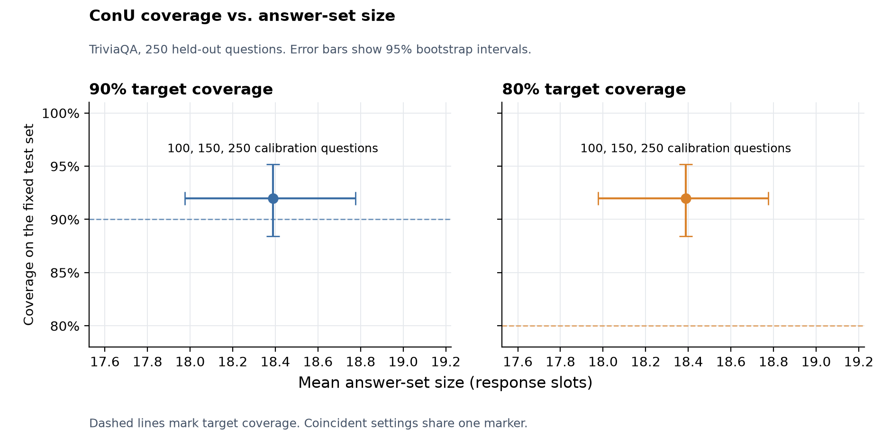

# ConU — Report Sections 1a, 2a, and 3a

## Part 1a — Reproduction of ConU on TriviaQA

### Input and output

We reproduced the short-answer prediction-set pipeline of Wang et al. (2024) using the active scoring and calibration rules in the released ConU implementation at commit `c0c450e8dbef489cfed28f585f1a4ddf0e66078b`. The input consists of a TriviaQA question and a fixed pool of sampled answers. The output is a set of retained answer positions. The benchmark answer is used to score correctness during calibration and evaluation. Constructing a set for a test question requires only its sampled answers and the calibrated threshold. [ConU paper](https://aclanthology.org/2024.findings-emnlp.404/) · [Pinned ConU implementation](https://github.com/Zhiyuan-GG/Conformal-Uncertainty-Criterion/blob/c0c450e8dbef489cfed28f585f1a4ddf0e66078b/conformal_uncertainty_criterion.py)

We froze 500 question IDs from the TriviaQA `rc.nocontext` validation split before generation, with 250 for calibration and 250 for testing. The IDs were selected in a seed-0 shuffled order after deduplication and were disjoint from the 100 development questions and three few-shot examples. We sampled 20 answers per question with Qwen2.5-14B-Instruct, for 10,000 answers in total. The run used a 36-token generation limit, temperature 1.0, top-p 0.9, and top-k 20. We applied the released answer-cleaning rules and preserved all response positions, including duplicate texts. The team generated this cache for the experiment and reused it for every later comparison. The brief asks the main reproduction to build on existing generations and annotations; the pinned ConU release we reproduce ships only scripts, with no cached generations and no scores, so there was nothing to reuse. We therefore froze the question pool and the calibration/test split before generation, sampled once, and re-ran every subsequent analysis — the filtering audit in Part 2a and all of Part 3a — from that single cached score matrix on CPU. The cost is 3.5 GPU-hours of generation, or 4.0 including scoring, out of the 20-hour budget, and the run plan records `reused_response_count = 0` so the choice is explicit. The A3 run configuration and the frozen selection are in the A4 reproduction package; the summary is [here][a3].

### Scoring and calibration

The `cross-encoder/stsb-roberta-large` scorer at revision `2b12c2c0088918e76151fd5937b7bba986ef1f98` compares question-prefixed cleaned answers. We score 190 unordered answer pairs per question, mirror those scores to form a symmetric matrix, and set the diagonal to 1. We also score each of the 20 answers against the canonical benchmark answer. A candidate is acceptable when its benchmark similarity is at least 0.60. This is a similarity-based proxy for correctness. A3 processing plan (in the A4 reproduction package) · Pair-scoring implementation (`a2_100_finish.py`, in the A4 reproduction package)

For each answer position $i$, let $f_i$ be the fraction of its 20 matrix entries that score at least 0.60, including its diagonal entry. The released implementation normalizes these frequencies within each question and uses $s_i=1-f_i/\sum_j f_j$ as the nonconformity score. The calibration reference is the score of the candidate with the highest benchmark similarity, with ties resolved by the first position. For $n$ calibration questions and error level $\alpha$, we use the NumPy `higher` quantile of those reference scores at level $\lceil(n+1)(1-\alpha)\rceil/n$, matching the released implementation. The prediction set retains every position with $s_i\le\hat q$. Coverage is the fraction of test questions whose set contains at least one acceptable candidate. Mean set size counts retained positions, including duplicates. [Pinned scoring and quantile code](https://github.com/Zhiyuan-GG/Conformal-Uncertainty-Criterion/blob/c0c450e8dbef489cfed28f585f1a4ddf0e66078b/conformal_uncertainty_criterion.py#L109-L170) · A3 evaluator (`a3_run.py`, in the A4 reproduction package)

The A3 reproduction applies ConU's eligibility rule within the fixed partitions. The released evaluator applies it before splitting. With 243 eligible calibration questions, both the 90% and 80% targets produce $\hat q=0.95$. On 232 eligible test questions, coverage is 230/232 (99.14%) and the mean size is 18.543 positions. Applying the same threshold to all 250 test questions gives 230/250 (92.0%), with 18.388 retained positions and 6.308 distinct cleaned texts per question on average. [A3 summary][a3] · [Pinned filter and split](https://github.com/Zhiyuan-GG/Conformal-Uncertainty-Criterion/blob/c0c450e8dbef489cfed28f585f1a4ddf0e66078b/conformal_uncertainty_criterion.py#L88-L104)

Successful A3 generation requests sum to 12,720.5 seconds, measured after server startup. The scoring session took 1,666.1 seconds to load the scorer, evaluate 105,000 pairs and save the scores. It recorded about 1.34 GiB peak PyTorch CUDA allocation on an NVIDIA A800 40 GB MIG instance. The filtering audit and both calibration experiments reuse the scores on CPU, so changing the target or calibration size requires no additional model calls. Generation request records (in the A3 cache, held by the team) · Scoring session log (in the A3 cache, held by the team) · [A5 grid runner](../../src/confqa/conu/a5_grid.py)

## Part 2a — Filtering audit and short-answer cases

### Effect of filtering

We reran calibration with and without the eligibility filter while preserving the frozen question assignments. The filter removes questions whose sampled pool contains no acceptable answer. It excludes 25 of 500 questions (5.0%), including seven calibration questions and 18 test questions. The unfiltered run uses the highest-similarity candidate as its calibration reference for every question, including those below the acceptance cutoff. Both variants are independently calibrated at each target. [A4 filter audit][a4]

| Evaluation | Calibration questions | Test questions | $\hat q$, both targets | Covered | Mean retained positions | Result |
|---|---:|---:|---:|---:|---:|---|
| Filtered calibration and test | 243 | 232 | 0.95 | 230/232 (99.14%) | 18.543 | [A4 summary][a4] |
| Unfiltered calibration and test | 250 | 250 | 0.95 | 230/250 (92.0%) | 18.388 | [A4 summary][a4] |

Both runs retain the same candidate positions for each question they share. The 7.14 percentage-point difference comes from removing the 18 test questions with no acceptable candidate. Even returning every candidate would cover at most 232/250 questions (92.8%) under the scoring rule. The evaluated sets fall two questions short of that ceiling because they discard every acceptable candidate on those two questions. [A4 filter audit][a4] · [A3 summary][a3]

### Success and failure cases

We selected these cases from the fixed test set after evaluation to illustrate how the prediction set succeeds or fails. The case record contains each question, its benchmark answer, all 20 original completions, the per-answer scores, and the retained positions. [A6 case record](A-conu-cases.md)

| Outcome and question ID | What happened |
|---|---|
| Success, `dpql_825` | The first answer names Sarah Lancashire. The 12-position set includes Nicola Walker, the benchmark answer. |
| Success, `qw_3850` | The first answer places the 1999 Rugby World Cup final in Dublin. The 15-position set includes Cardiff, Wales, consistent with the benchmark answer Wales. |
| Failure, `odql_4634` | All 20 cleaned answers locate the Caledonian Brewery in Perth, Scotland, and all survive the cutoff. The benchmark answer is Edinburgh. |
| Failure, `bt_3134` | Mars is the only acceptable answer. Its nonconformity is 0.997, above the 0.95 cutoff, and none of the 18 retained positions is acceptable. |

Alternative answers can recover a correct name or place after an incorrect first sample. The Perth case shows how repeated errors earn high agreement, and the Mars case shows how a rare correct answer can be discarded. The similarity proxy can also credit an uninformative answer. In `qw_4781`, a generic statement about confusion exceeds the cutoff for benchmark similarity. [A6 case record](A-conu-cases.md)

Short-answer coverage rewards the presence of at least one acceptable alternative. Long-form factuality asks whether every retained claim is acceptable, so it can remove a bad claim while preserving useful claims from the same response. At the 90% target with the full long-form calibration pool, 24 of 25 responses meet the all-correct criterion when empty responses count, and 17 of 25 meet it with content remaining. The filter retains 45 of 210 claims. These counts illustrate the usefulness cost of removing content, alongside the short-answer cost of keeping many alternatives. [Long-form result JSON](../../exp/results/fact__a0.1__calib1.json)

## Part 3a — Target coverage and calibration size

### Fixed calibration subsets

We varied the target coverage (90% or 80%) and calibration size (100, 150, or 250 questions). The subsets are nested prefixes of the frozen A3 calibration order. Every setting uses the same 250 held-out test questions, the same scores and the same 20 candidate positions per question. Calibration and testing include questions with no acceptable candidate. [A5 configuration](../../configs/conu_a5.json) · Frozen selection (in the A4 reproduction package)

| Target | Calibration questions | $\hat q$ | Coverage | Mean retained positions | Result |
|---|---:|---:|---:|---:|---|
| 90% | 100 | 0.95 | 92.0% | 18.388 | [conu__a0.1__calib0.4.json](../../exp/results/conu__a0.1__calib0.4.json) |
| 90% | 150 | 0.95 | 92.0% | 18.388 | [conu__a0.1__calib0.6.json](../../exp/results/conu__a0.1__calib0.6.json) |
| 90% | 250 | 0.95 | 92.0% | 18.388 | [conu__a0.1__calib1.json][a5-full] |
| 80% | 100 | 0.95 | 92.0% | 18.388 | [conu__a0.2__calib0.4.json](../../exp/results/conu__a0.2__calib0.4.json) |
| 80% | 150 | 0.95 | 92.0% | 18.388 | [conu__a0.2__calib0.6.json](../../exp/results/conu__a0.2__calib0.6.json) |
| 80% | 250 | 0.95 | 92.0% | 18.388 | [conu__a0.2__calib1.json](../../exp/results/conu__a0.2__calib1.json) |

All six cells have 95% intervals of [88.4%, 95.2%] for coverage and [17.976, 18.776] for mean size. These percentile intervals use 10,000 bootstrap resamples of test questions with seed 0 and hold the fitted threshold fixed. The same retained sets and test outcomes produce the same intervals. The mean set retains about 92% of the 20 available positions, so the observed coverage comes with limited reduction in the number of responses a reader must consider. [Full-pool A5 result][a5-full] · [A5 configuration](../../configs/conu_a5.json)

*Figure. Coverage versus mean retained positions, with a maximum of 20 positions per question. The three calibration sizes coincide in each panel and share a marker. Error bars are the 95% test-question bootstrap intervals at fixed calibration.* [Figure source data][a5-full]

### Random calibration subsets

To vary the composition of the calibration set, we drew 1,000 uniform subsets without replacement at each size using seed 0, shared each draw across the two targets, and recalibrated with the same `higher` quantile. We kept the test questions, candidate answers and scores fixed. The 250-question setting always uses the full pool, so it has one distinct subset. For every size and target, the empirical 5th and 95th percentiles were both 0.95 for the cutoff and both 92.0% for coverage. These percentiles describe sensitivity to selecting a subset of this calibration pool. [Resampling results][resampling] · [Resampling script][resampling-script]

The score normalization produces 0.95 when all 20 agreement frequencies are equal, since each normalized frequency is then 1/20. In the full calibration pool, 199 of 250 reference scores equal 0.95. This concentration keeps the cutoff at 0.95 in most draws. At 100 calibration questions and the 90% target, a few draws moved the cutoff upward, reaching 0.95226131. The next test coverage breakpoint is 0.98, the smallest cutoff that would add coverage for a currently uncovered question. Every observed cutoff therefore covers the same 230 questions. An independent resampling run reached the same coverage and central cutoff percentiles. This pattern depends on the distribution of scores and the test coverage breakpoints on this fixed split. [Pinned scoring rule](https://github.com/Zhiyuan-GG/Conformal-Uncertainty-Criterion/blob/c0c450e8dbef489cfed28f585f1a4ddf0e66078b/conformal_uncertainty_criterion.py#L119-L135) · [Resampling results][resampling] · [Test coverage cutoffs][cutoffs] · [Independent review][review]

[a3]: ../../exp/handoff/a5_resampling/results/summary.json
[a4]: ../../exp/handoff/a5_resampling/cache/a4_filter_audit/summary.json
[a5-full]: ../../exp/results/conu__a0.1__calib1.json
[resampling]: ../../exp/handoff/a5_resampling/a5_calibration_resampling.json
[resampling-script]: ../../exp/handoff/a5_resampling/a5_resample_calibration.py
[cutoffs]: ../../exp/handoff/a5_resampling/test_coverage_cutoffs.json
[review]: A5-resampling-review.md
