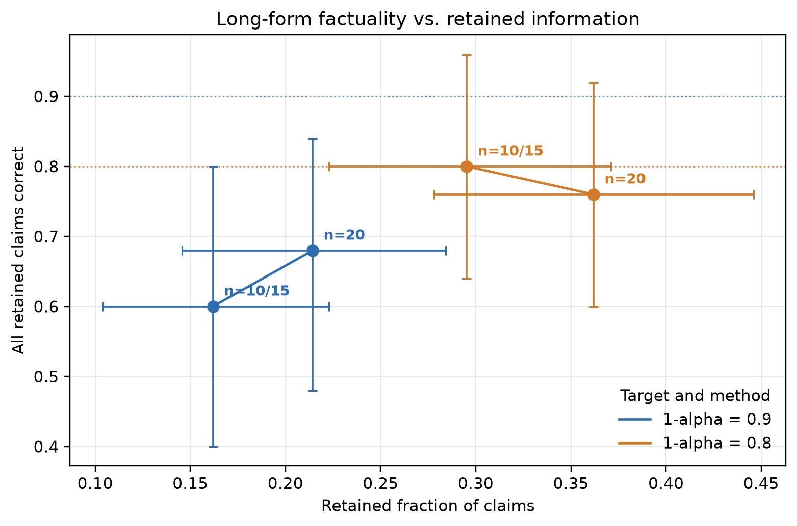

# B 校准集大小网格记录

## 设置

- alpha：0.1 / 0.2
- calibration pool：20 条
- calibration fraction：0.5 / 0.75 / 1.0
- 实际 calibration 数量：10 / 15 / 20
- test：固定 25 条
- 每个 alpha 的 calibration 子集采用相同 seed，并逐级嵌套
- CI：对 test response 做 10,000 次 percentile bootstrap

## 结果

| alpha | 1-alpha | calib n | threshold | all-correct nonempty | 95% CI | retention | 95% CI | empty rate | 95% CI |
|---:|---:|---:|---:|---:|---|---:|---|---:|---|
| 0.1 | 0.9 | 10 | 5.00007 | 0.60 | [0.40, 0.80] | 0.1619 | [0.1038, 0.2227] | 0.36 | [0.16, 0.56] |
| 0.1 | 0.9 | 15 | 5.00007 | 0.60 | [0.40, 0.80] | 0.1619 | [0.1038, 0.2227] | 0.36 | [0.16, 0.56] |
| 0.1 | 0.9 | 20 | 4.99964 | 0.68 | [0.48, 0.84] | 0.2143 | [0.1456, 0.2842] | 0.28 | [0.12, 0.48] |
| 0.2 | 0.8 | 10 | 4.99876 | 0.80 | [0.64, 0.96] | 0.2952 | [0.2227, 0.3709] | 0.12 | [0.00, 0.28] |
| 0.2 | 0.8 | 15 | 4.99876 | 0.80 | [0.64, 0.96] | 0.2952 | [0.2227, 0.3709] | 0.12 | [0.00, 0.28] |
| 0.2 | 0.8 | 20 | 3.99988 | 0.76 | [0.60, 0.92] | 0.3619 | [0.2780, 0.4459] | 0.12 | [0.00, 0.28] |

## 图形



报告图同时提供：

- `figures/retention_vs_factuality.png`
- `figures/retention_vs_factuality.pdf`

横轴是 retained claim 比例，纵轴是非空且 retained claims 全对的比例。横纵误差棒
都是固定 seed 的 95% bootstrap CI。10 条和 15 条校准的结果完全重合，因此合并为
一个 `n=10/15` 标注，避免后画的点遮住前一个点。

图中橙色点在 retention 上整体位于蓝色点右侧，说明目标更宽松时保留信息更多；
但两组 alpha 的 CI 重叠明显，不能把当前差异解释为稳定的统计显著效应。

所有结果均由以下命令生成：

```bash
PYTHONPATH=src .venv/bin/python -m confqa.factuality.cli grid \
    --config configs/factuality.yaml
```

## 观察

1. 10 条和 15 条校准给出相同阈值，说明新加入的 5 条没有改变当前分位点对应的 rank score。
2. 使用完整 20 条后，两种 alpha 的阈值都发生变化；retention 均上升，说明保留的 claim 变多。
3. alpha=0.1 时，完整校准同时把 empty rate 从 0.36 降到 0.28，并使 headline all-correct 从 0.60 升到 0.68。
4. alpha=0.2 时，完整校准使 retention 上升，但 headline all-correct 从 0.80 轻微降到 0.76。
5. 25 条 test 很小，六组 CI 有明显重叠；目前只能描述趋势，不能声称校准集大小带来了稳定因果效应。

## 一致性检查

- 6 个结果文件的 `reportable` 均为 `true`。
- 6 个结果使用相同的 `test_ids_sha256`、`split_sha256` 和 `scored_sha256`。
- calibration 子集满足 10 条 subset of 15 条 subset of 20 条。
- 每个结果都记录完整 calibration ID 列表、阈值、三个主指标和 CI。

## 结果文件

- `exp/results/fact__a0.1__calib0.5.json`
- `exp/results/fact__a0.2__calib0.5.json`
- `exp/results/fact__a0.1__calib0.75.json`
- `exp/results/fact__a0.2__calib0.75.json`
- `exp/results/fact__a0.1__calib1.json`
- `exp/results/fact__a0.2__calib1.json`
