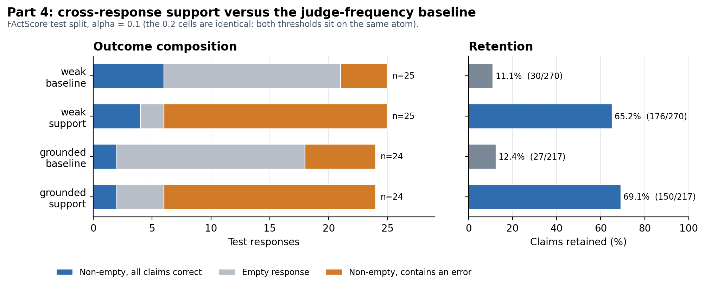

# Part 4: cross-response claim scoring (C)

Status: complete. Every number below comes from a committed result file:
`exp/results/extension/grounded/` for the headline table and
`exp/results/extension/weak/` for the discarded-label reference. Both sets were
produced by `python -m confqa.extension.evaluate` at commit `3d63eed` with
`reportable: true` and a clean work tree.

## What was built

1. 50 FActScore prompts x 5 responses from Qwen2.5-14B-Instruct
   (`cache/ext_responses.jsonl`, 292 s of generation).
2. H3 pipeline: 250 responses split into claims, target response judged against
   the other four (`cache/h3/`, 500 calls, 0 parse failures).
3. Extension: claims from different responses merged by cross-encoder
   similarity >= 0.6, `support = (#responses in the cluster) / 5`
   (`cache/ext/clusters.jsonl`, 550 target claims).
4. Two label sets: a memory-only LLM judge, then a retrieval-grounded relabel
   against cached Wikipedia extracts (`data/wiki_cache/`).

Both scorers use the same claims, the same labels, the same 25/25 split and the
same split-conformal rule, so the comparison is at an identical sampling budget.

## Label audit: why the first pass was thrown away

The memory-only judge labelled 550 claims. Seventeen claims were checked by hand
against Wikipedia; **6 of them were wrong (35%)**, in three modes:

- plausible but false (a baseball pitcher judged "football player")
- true but judged false (a Paralympic medallist judged not an athlete)
- true but off-topic (a statement about a restaurant chain counted as support
  for a claim about a musician)

The retrieval-grounded relabel fixed the source. Verdict distribution:

| verdict | count | share |
|---|---:|---:|
| not_claim | 98 | 17.8% |
| supported | 77 | 14.0% |
| contradicted | 87 | 15.8% |
| absent | 288 | 52.4% |

**17.8% of extracted "claims" are not factual assertions at all** — sentences
like "more details about X are needed". The memory-only judge marked them true,
inflating factuality; the grounded pass tags them `not_claim` and drops them.

## Does cross-response support track truth?

Among the 452 real claims:

| support | supported | contradicted | absent | supported rate |
|---|---:|---:|---:|---:|
| 0.2 | 5 | 31 | 74 | 4.5% |
| 1.0 | 66 | 50 | 188 | 21.7% |

Support carries signal — a 5x lift from 0.2 to 1.0 — but it is a weak filter:
at the strictest possible threshold, 78% of retained claims are still not
supported by the article, and **16.4% are directly contradicted**. Those are
claims all five samples agreed on and Wikipedia denies: a shared hallucination,
not random noise.

## Headline comparison (grounded labels, 24 test responses)

The test split holds 25 prompts but only 24 survive grounded labelling: one
prompt has every claim tagged `not_claim` and drops out. Every rate below is
therefore an exact fraction of 24.

| method | threshold | vacuous all-correct | non-empty all-correct | retention | empty rate |
|---|---:|---:|---:|---:|---:|
| baseline (judge frequency) | 5.0 | **0.750** (18/24) | 0.083 (2/24) | 0.124 | 0.667 (16/24) |
| extension (support) | 1.0 | 0.250 (6/24) | 0.083 (2/24) | **0.691** | 0.167 (4/24) |

At this sample size the intervals are wide: Wilson 95% for vacuous all-correct
is 0.551-0.880 versus 0.120-0.449, and 0.023-0.258 for non-empty all-correct on
both rows.

The extension keeps 5.6x more claims and is three times less reliable. Neither
reaches its nominal target (0.9 / 0.8): the baseline empties two thirds of the
responses and still misses.

**Both filters leave exactly two fully correct non-empty responses.** The
0.75 versus 0.25 gap is therefore a difference in how often the response is
emptied, not in how often what survives is correct. The non-empty column, not
the vacuous one, is where the two methods are actually identical.

The figure is generated by `src/confqa/extension/report.py` from the committed
result files. It is drawn at alpha = 0.1 only: the alpha = 0.2 cells are identical because
both thresholds land on the same atom of the claim-level score distribution, and
the script asserts that the two alphas agree before printing one set of bars.

### The discarded weak labels, side by side

| labels | method | vacuous all-correct | non-empty | retention | empty rate | responses | claims |
|---|---|---:|---:|---:|---:|---:|---:|
| weak | baseline | 0.840 | 0.240 | 0.111 | 0.600 | 25 | 270 |
| weak | support | 0.240 | 0.160 | 0.652 | 0.080 | 25 | 270 |
| grounded | baseline | 0.750 | 0.083 | 0.124 | 0.667 | 24 | 217 |
| grounded | support | 0.250 | 0.083 | 0.691 | 0.167 | 24 | 217 |

Grounding the labels dropped the baseline from 0.840 to 0.750 and left the
extension at 0.24-0.25. **The weak labels flattered the baseline**, because the
memory-only judge counted meta-commentary and off-topic sentences as true.

The two label sets do not score the same claims (270 versus 217): retention is a
ratio computed within each set, so the weak/grounded pairs are comparable, but
the raw claim counts are not.

## The two objections the label audit left open

The grounded labels came from a judge that saw only the first 3,000 characters of
each extract, and that extract was also the evidence it was checking against.
Part 5 tests both objections with an independent blind protocol
([part5-evidence-adjudication.md](../../reports/part5-evidence-adjudication.md));
three of its results bear directly on the numbers above.

**Truncation does not inflate them.** Forty claims were re-adjudicated under two
conditions, extract cut at 3,000 characters and whole extract. Of the 24 claims
whose two copies genuinely differ, exactly one changed verdict, and it changed
toward the weaker verdict when the text was cut. That is the only direction the
protocol allows: a `supported` or `contradicted` verdict needs positive evidence
inside the visible window, so hiding text can only turn those into `unknown`.
The cap makes the rates below conservative.

**The adjudicator is not deterministic.** Sixteen of the forty claims had
byte-identical evidence in both conditions; two of the sixteen received different
verdicts. The measurement floor is about 12%, so differences of that size in this
section are not interpretable.

**"Contradicted" is a definition.** Of the 21 claims the grounded judge called
contradicted, the independent adjudicator recovered 3 and returned 18 `unknown`,
because an invented career is *not mentioned* by the article rather than refuted
by it. The stricter reading is what the protocol mandates, and it cannot catch
whole-cloth fabrication — the dominant error in these responses.

## The similarity threshold, measured

Stricter clustering thresholds confine the 0.6 default's problem to the encoder,
not to the threshold:

| threshold | clusters | mean size | real claims at unanimous support | contradicted among them | rate |
|---:|---:|---:|---:|---:|---:|
| 0.60 | 227 | 2.42 | 304 | 50 | 16.4% |
| 0.75 | 458 | 1.20 | 79 | 8 | 10.1% |
| 0.85 | 535 | 1.03 | 14 | 3 | 21.4% |
| 0.90 | 546 | 1.01 | 4 | 0 | 0.0% |

Coverage collapses first — 67% to 0.9% of the 452 real claims — while the
contradiction rate does not fall. Claims all five samples agree on and Wikipedia
denies are agreements, and no similarity threshold undoes an agreement. The 0.85
and 0.90 cells rest on 14 and 4 claims and should be read as "no better", not
"better".

## What this means

- The extension is a **negative result**. Consistency is a real but weak signal;
  it does not separate "repeated truth" from "repeated error".
- The dominant failure mode is not the clustering threshold. Support collapses
  to 1.0 for 65% of claims because the encoder merges almost every pair at 0.6,
  so the score has almost no range to calibrate on.
- Claim decomposition itself is a source of error: one in six "claims" is
  meta-commentary.
- Under strict verification, conformal factuality filtering is hard to satisfy
  on this data at all: most generated content is simply not verifiable, so
  "remove uncertain claims" removes most of the response.

## Limitations

- "absent" is not "false": a claim can be true but absent from a 3,000-character
  extract of a short article. All absent claims are counted as unsupported,
  following the FActScore convention, which biases factuality down.
- Two entities (Joeri Adams, Carlos Alfonso) have only disambiguation pages.
- The test half holds 25 responses and 24 survive grounded labelling, so every
  rate above is a multiple of 1/24 and the intervals are wide. A one-response
  change moves the vacuous all-correct rate by 4 points.
- The extension's similarity threshold was fixed at 0.6 for comparability with
  the short-form line, not tuned. The sensitivity analysis above shows that
  tuning it would not have helped.
- **Run-to-run noise is about 12%** on byte-identical input (Part 5, paired
  probe). The four-way tables in this section differ by less than that in some
  cells, and those cells should not be over-read.
- **The contradiction rate is conditional on a definition.** It counts "the
  article asserts something incompatible" together with "the article never
  mentions the fabrication". Under a strict evidence-only reading most of those
  claims are `unknown`, so 16.4% is an upper bound on what evidence can refute.
- The label audit in this section used the same cached extract as the evidence it
  was checking. Part 5 re-adjudicates 40 of these claims with an independent
  protocol and reproduces the direction of the conclusion, not the exact rates.
