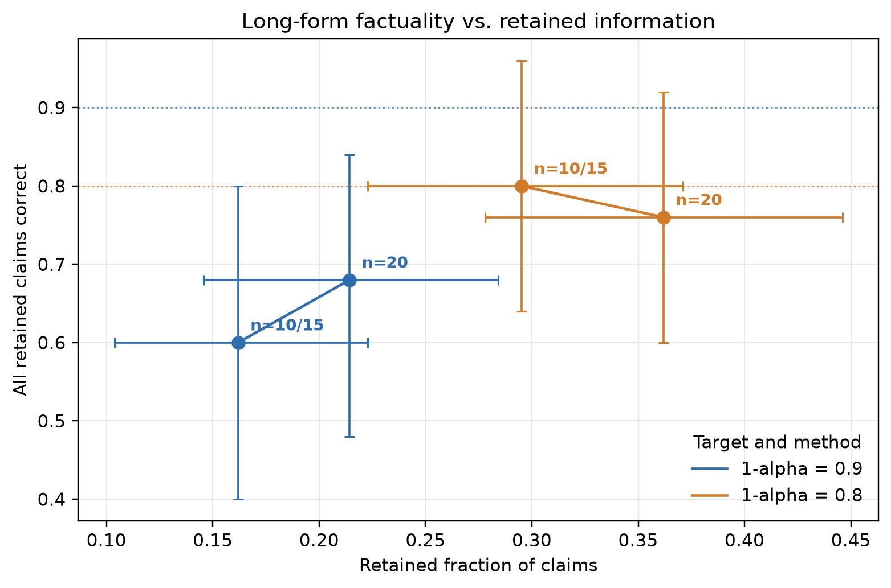

# Conformal Factuality: Report Sections 1b, 2b, and 3b

This draft covers the long-form factuality branch. It uses cached GPT-4
generations, human claim annotations, and cached frequency scores released with
the official implementation. It does not claim to reproduce every experiment in
the original paper.

## Part 1b: Reproduction of Conformal Factuality

### Input and output

The experiment uses the FActScore biography subset shipped with
`conformal-factual-lm` at commit
`6022b4c90c6580f524f123b0cb97bbb61ab621d1`. The cached input contains 50
biography prompts and 408 atomic claims. Each claim has a four-way human
annotation and cached claim-confidence scores.

The four annotation labels are:

- `Y` (Factual): supported by a reliable factual source.
- `S` (Subjective): an evaluative or subjective statement. The original method
  treats this label as acceptable.
- `N` (False): contradicted or factually incorrect.
- `U` (Unverifiable): no sufficient evidence was found to verify or reject the
  claim.

We define the accepted set as \(A=\{\mathrm{Y},\mathrm{S}\}\). `N` and `U`
are excluded from the accepted set. This is conservative: `U` does not imply
that the claim is false, only that its truth was not established.

The input example for one response is:

```json
{
  "prompt": "Tell me a paragraph bio of ...",
  "claims": [
    {
      "subclaim": "...",
      "annotation": "Y",
      "frequency-score": 5.0,
      "noise": 0.0004
    }
  ]
}
```

The pipeline outputs a retained subset of claims. We evaluate the retained
claims rather than regenerating a fluent merged paragraph.

### Frequency scoring

For each claim, the upstream repository generates five alternative responses
to the same prompt. A GPT-4 judge classifies the claim against each alternative
response as support \((+1)\), contradiction \((-1)\), or unrelated \((0)\).
The cached frequency score is:

\[
s_{\mathrm{freq}}(c)=\sum_{r=1}^{5}\mathrm{Judge}(c,a_r)
\]

Thus, the score ranges from \(-5\) to \(5\). A score of 5 means that all five
alternatives support the claim. A score of 0 can result from no support, a
mixture of support and contradiction, or the claim simply not being mentioned.
The score measures cross-sample support, not external truth.

The repository adds a small cached Gaussian tie-break term to every score:

\[
\tilde{s}(c)=s_{\mathrm{freq}}(c)+\epsilon
\]

We reproduce this behaviour because it is part of the released pipeline.

### Data split and calibration

We freeze the IDs before running the experiments:

- 25 test responses;
- 5 development responses, not used for the reported numbers;
- 20 calibration-pool responses.

The 20-response pool is sampled without replacement at fractions
\(0.5\), \(0.75\), and \(1.0\), producing calibration sets of 10, 15, and
20 responses. The samples are nested under a fixed seed, and the test set is
identical across every run.

For each calibration response, the rank score identifies the first threshold
at which filtering would retain an unaccepted claim. The split-conformal
threshold is the finite-sample upper quantile:

\[
q=\left\lceil(n+1)(1-\alpha)\right\rceil
\]

where \(n\) is the calibration size. The threshold is applied as:

\[
\tilde{s}(c)\ge\tau
\]

The course metric requires every retained claim to be correct, so the
claim-level required fraction is fixed at \(a=1\). This is distinct from the
conformal error rate \(\alpha\).

### Correctness criterion and metrics

We report three headline metrics:

- **All-correct nonempty:** the fraction of all test responses that retain at
  least one claim and whose retained claims are all annotated `Y` or `S`.
- **Retention:** the number of retained claims divided by the number of original
  claims.
- **Empty rate:** the fraction of responses with no retained claim.

Empty responses are not counted as successful all-correct answers. They are
reported separately because an empty set is safe only in the narrow sense that
it contains no incorrect claim.

Using 20 calibration responses and \(1-\alpha=0.9\), the threshold is
`4.999642`. The nonempty all-correct rate is `0.68` with a 95% response-level
bootstrap CI of `[0.48, 0.84]`; retention is `0.2143` `[0.1456, 0.2842]`;
empty rate is `0.28` `[0.12, 0.48]`.

The reported result is from
`exp/results/fact__a0.1__calib1.json`. It is marked `reportable=true` and is
tied to `data/splits/factscore.json` and the pinned upstream score file.

### Scope of reproduction

This section reproduces the calibration, filtering, and evaluation stages from
cached outputs. It does not deploy a new generator, repeat claim decomposition,
or regenerate the five alternative responses. The upstream cached model is
recorded as `upstream-cached:gpt-4`.

## Part 2b: Suitability and Failure Analysis

### Response-level outcomes

With 20 calibration responses and \(1-\alpha=0.9\), the 25 test responses
split into:

| Outcome | Count |
|---|---:|
| Nonempty and all retained claims correct | 17 |
| Empty response | 7 |
| Nonempty but retained set contains `N` | 1 |
| Total | 25 |

Conditioned on retaining at least one claim, 17 of 18 responses have an
entirely correct retained set. The main concern is therefore usefulness:
28% of all test responses are completely empty.

The result source is `exp/results/fact__a0.1__calib1.json`. The detailed
case evidence is in `docs/analysis/B-factuality-cases.md`.

### Claim-level selection behaviour

The 25 test responses contain 210 claims:

| Annotation | Total | Retained | Dropped | Retention |
|---|---:|---:|---:|---:|
| `Y` | 111 | 40 | 71 | 36.0% |
| `S` | 24 | 4 | 20 | 16.7% |
| `N` | 52 | 1 | 51 | 1.9% |
| `U` | 23 | 0 | 23 | 0% |

Overall, 45 claims are retained and 44 are correct, giving a retained-claim
precision of 97.8%. However, only 44 of 135 accepted (`Y/S`) claims are
retained, giving a recall of 32.6%. The method is therefore conservative:
it removes 74 of 75 `N/U` claims but also removes 91 of 135 correct claims.

### Why correct claims are removed

The score distribution explains a large part of this behaviour:

| Frequency score | Correct claims | Correct and retained | Correct but dropped |
|---|---:|---:|---:|
| 5 | 66 | 44 | 22 |
| 4 | 12 | 0 | 12 |
| 1–3 | 45 | 0 | 45 |
| 0 | 2 | 0 | 2 |
| Negative | 10 | 0 | 10 |

Four mechanisms are visible.

First, the threshold `4.999642` is slightly above 5. Consequently, even a
claim supported by all five alternatives can fail if its tie-break noise is
negative. This accounts for 22 correct claims with score 5. For example, a
correct claim about the film *Hello, Dolly!* has score 5 and noise
`-0.000489`, producing an adjusted score of `4.999511`, below the threshold.

Second, a claim can be correct but absent from most alternative responses.
The judge then returns unrelated rather than contradiction. Specific awards,
books, offices, dates, and venues are especially likely to be omitted across
free-form samples.

Third, compound statements are vulnerable to partial support. A claim that
combines birth and death dates, or several offices and dates, may fail when an
alternative supports only one component. Among correct claims, compound
statements account for 11.4% of retained claims but 17.6% of dropped claims.

Fourth, referential and subjective claims are less stable across resampling.
Claims beginning with `he`, `she`, `his`, `her`, `this`, or `another` account
for 6.8% of correct retained claims but 18.7% of correct dropped claims.
Subjective `S` claims account for 9.1% of retained correct claims but 22.0% of
dropped correct claims. These statements depend on entity matching,
paraphrase, or evaluative wording, and the five alternatives often express them
differently.

Ambiguous entity prompts form an additional failure mode. For names shared by
multiple people, different samples may describe different entities. A correct
claim about one candidate can therefore receive no support when an alternative
focuses on another candidate.

### Why an incorrect claim can be retained

In the test split, one `N` claim receives score 5 and is retained:

> Rennie Fritchie is a British public servant.

This statement appears plausible, so the disagreement may reflect either
annotation/source disagreement or a repeated model judgement error. With only
one observed case, we cannot estimate a false-positive rate.

More generally, frequency scoring cannot distinguish consensus from truth.
Five samples from the same model are correlated; repeated hallucinations can
receive high support. An accompanying unverifiable claim can also receive
score 5 while remaining unsupported by an external source.

### Representative cases

**Successful filtering.** For `factscore-0027` (Sharad Kumar), the retained
set preserves identity, nationality, birth information, and a major Paralympic
achievement while removing two incorrect medal claims. The answer remains
useful despite dropping secondary details.

**Partial success with information loss.** For `factscore-0049` (Zamfir
Arbore), all `N/U` claims are removed and the retained set keeps identity,
dates, and origin. However, information about his historical work and political
activity is also removed. The output is safer but noticeably thinner.

**Correct but too incomplete.** For `factscore-0034` (Rin Iwanaga), the only
retained claim says that the person could be a private individual. It is not
false, but it does not answer the biography request. For `factscore-0046`
(Carlos Alfonso), the retained set acknowledges name ambiguity but removes
alternative candidates, making the ambiguity harder to understand.

**Empty output.** For `factscore-0020` (Luis Guillermo Rivera), the original
response contains nine `N` claims and one correct claim with score 2. All ten
are removed. For `factscore-0023` (Roxana Díaz), all three correct claims are
also below the threshold. Empty filtering prevents incorrect output but loses
valid information.

### Difficult-example exclusion

The released cache contains all 50 response records and 408 claims. We observe
no response-level removal and no empty claim set. The cached merge output also
contains all 50 rows and no missing `accepted-subclaims` or `new-output` fields.
Four rows contain no accepted claim and produce `Abstain.`.

Claim decomposition and merge failures cannot be fully audited because the
upstream repository does not archive parse-failure logs. We therefore report
their rate as unknown rather than claiming zero.

### Answer to the Part 2 questions

Claim filtering is useful for long responses because a single paragraph can
mix reliable and unreliable statements. Filtering improves the correctness of
the retained text but can remove most or all useful information. When repeated
sampling never supplies a claim, even a correct low-frequency statement may be
discarded. The observed empty responses and sparse biographies show that such
filtering can make an answer factually safe but incomplete.

Coverage and factuality are therefore different objectives. Coverage asks
whether a set of alternatives contains at least one correct answer; factuality
asks whether the claims in a response are acceptable. Neither metric implies
the other.

## Part 3b: Calibration-Size Study

### Design

We compare two target levels, \(1-\alpha=0.9\) and \(0.8\), with three
calibration sizes selected from the same 20-response pool:

- 10 responses (`calib_frac=0.5`);
- 15 responses (`calib_frac=0.75`);
- 20 responses (`calib_frac=1.0`).

The 25 test responses, confidence method, model scores, seed, and split are
held fixed. Tests are never used for threshold selection.

### Results

| Target | Calibration n | Threshold | All-correct | 95% CI | Retention | 95% CI | Empty | 95% CI |
|---:|---:|---:|---:|---|---:|---|---:|---|
| 0.9 | 10 | 5.00007 | 0.60 | [0.40, 0.80] | 0.1619 | [0.1038, 0.2227] | 0.36 | [0.16, 0.56] |
| 0.9 | 15 | 5.00007 | 0.60 | [0.40, 0.80] | 0.1619 | [0.1038, 0.2227] | 0.36 | [0.16, 0.56] |
| 0.9 | 20 | 4.99964 | 0.68 | [0.48, 0.84] | 0.2143 | [0.1456, 0.2842] | 0.28 | [0.12, 0.48] |
| 0.8 | 10 | 4.99876 | 0.80 | [0.64, 0.96] | 0.2952 | [0.2227, 0.3709] | 0.12 | [0.00, 0.28] |
| 0.8 | 15 | 4.99876 | 0.80 | [0.64, 0.96] | 0.2952 | [0.2227, 0.3709] | 0.12 | [0.00, 0.28] |
| 0.8 | 20 | 3.99988 | 0.76 | [0.60, 0.92] | 0.3619 | [0.2780, 0.4459] | 0.12 | [0.00, 0.28] |



Every point is produced from one of:

- `exp/results/fact__a0.1__calib0.5.json`
- `exp/results/fact__a0.1__calib0.75.json`
- `exp/results/fact__a0.1__calib1.json`
- `exp/results/fact__a0.2__calib0.5.json`
- `exp/results/fact__a0.2__calib0.75.json`
- `exp/results/fact__a0.2__calib1.json`

The figure is regenerated with:

```bash
PYTHONPATH=src .venv/bin/python -m confqa.factuality.cli report
```

### Interpretation

The 10- and 15-response calibration sets produce identical thresholds and
metrics for both targets. The additional five responses do not move the
selected conformal quantile. Using all 20 responses changes the threshold.

At \(1-\alpha=0.9\), increasing calibration from 10 to 20 raises retention
and all-correct while reducing the empty rate. At \(1-\alpha=0.8\), retention
increases, but all-correct decreases slightly from 0.80 to 0.76.

The differences should be interpreted cautiously. The test set has only 25
responses, and the confidence intervals overlap. In addition, frequency scores
are discrete, and the conformal threshold can sit just above score 5 because
of the tie-breaking noise. The study is therefore descriptive and does not
establish a stable causal effect of calibration size.

## Limitations

- The reported experiment uses 25 test responses from one benchmark subset.
- The main pipeline starts from cached claims and cached GPT-4 frequency
  scores; it does not generate new responses or recompute claim decomposition.
- The cache does not contain individual support/contradiction/unrelated judge
  verdicts for the five alternatives.
- Human labels and LLM judge decisions answer different questions: external
  factuality versus cross-sample support.
- The calibration sets are small and nested, so the discrete score threshold
  and tie-breaking noise materially affect retention.
- Empty outputs satisfy the narrow condition of containing no incorrect claim
  but are not useful answers.

## References

1. Mohri, C. and Hashimoto, T. *Language Models with Conformal Factuality
   Guarantees.* arXiv:2402.10978, 2024.
2. Min, S. et al. *FActScore: Fine-grained Atomic Evaluation of Factual
   Precision in Long Form Text Generation.* EMNLP, 2023.

