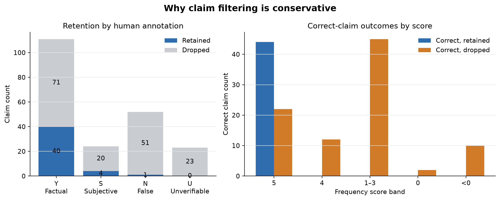
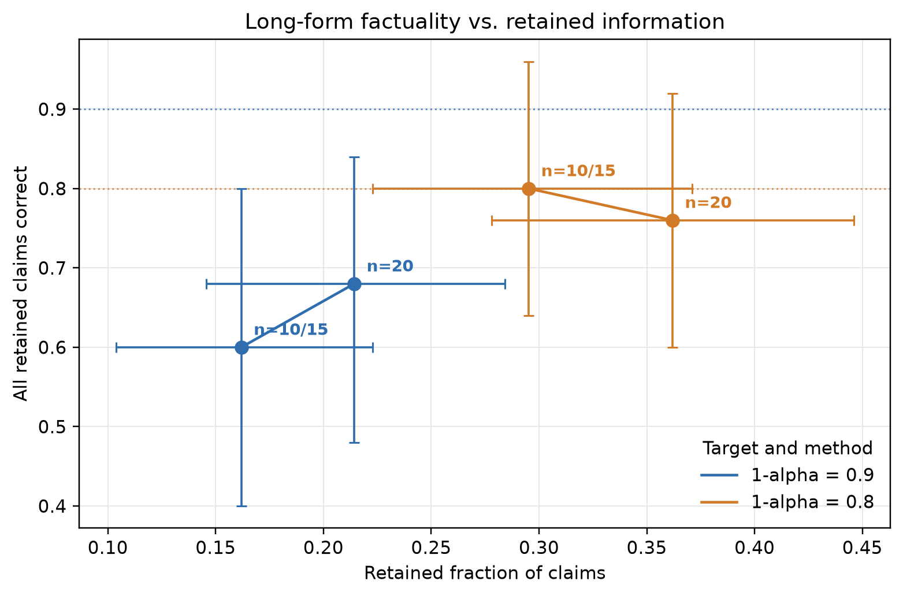

# Part B — Conformal Factuality for Long-Form Question Answering

This report covers the long-form factuality branch of the project. The main
experiment starts from the cached GPT-4 responses, human claim annotations, and
frequency scores released with the official
[`conformal-factual-lm`](https://github.com/tatsu-lab/conformal-factual-lm)
implementation. We reproduce calibration, filtering, and evaluation, then
study the reliability–usefulness trade-off and its failure cases. We do not
claim to reproduce every experiment in the original paper.

## Part 1b — Reproduction of Conformal Factuality

### Input and output

We use the FActScore biography subset at pinned commit
`6022b4c90c6580f524f123b0cb97bbb61ab621d1`. The cache contains 50 biography
prompts and 408 atomic claims. Each claim has a human factuality annotation, a
cached frequency score, and a small tie-breaking noise term.

The four annotation labels are:

- `Y` (**Factual**): supported by a reliable factual source.
- `S` (**Subjective**): an evaluative or subjective statement. The original
  method treats this label as acceptable.
- `N` (**False**): contradicted or factually incorrect.
- `U` (**Unverifiable**): insufficient evidence was found to verify or reject
  the claim.

We define the acceptable set as \(A=\{\mathrm{Y},\mathrm{S}\}\). Claims marked
`N` or `U` are excluded. This is deliberately conservative: `U` does not mean
that a claim is false, only that its truth was not established.

For each prompt, the input provides an original answer decomposed into claims:

```json
{
  "prompt": "Tell me a paragraph bio of ...",
  "claims": [
    {
      "subclaim": "...",
      "annotation": "Y",
      "frequency-score": 5.0,
      "noise": 0.0004
    }
  ]
}
```

The output is a retained subset of claims. We evaluate that subset directly
instead of generating another fluent merged paragraph.

### Frequency scoring

The upstream implementation generates five alternative responses to the same
prompt. A GPT-4 judge labels every claim–response pair as:

- support: \(+1\);
- unrelated: \(0\);
- contradiction: \(-1\).

The cached frequency score is:

\[
s_{\mathrm{freq}}(c)=\sum_{r=1}^{5}\mathrm{Judge}(c,a_r)
\]

The score therefore ranges from \(-5\) to \(5\). A score of 5 means that all
five alternatives support the claim. A score of 0 may mean that no alternative
mentions the claim, or that support and contradiction cancel.

This is a cross-sample consistency signal, not a probability of truth. The
original repository also adds a small cached Gaussian tie-break term:

\[
\tilde{s}(c)=s_{\mathrm{freq}}(c)+\epsilon
\]

We preserve this term because it is part of the released pipeline.

### Split and conformal calibration

We freeze all IDs before running the experiments:

- 25 test responses;
- 5 development responses, excluded from reported numbers;
- 20 calibration-pool responses.

The calibration pool is sampled at nested fractions \(0.5\), \(0.75\), and
\(1.0\), producing sets of 10, 15, and 20 responses. The same fixed-seed order
and the same 25 test responses are used for every run.

For each calibration response, the rank score marks the first threshold at
which filtering would accept an incorrect claim. For \(n\) calibration
responses and error level \(\alpha\), the split-conformal upper quantile is:

\[
q=\left\lceil(n+1)(1-\alpha)\right\rceil
\]

A claim is retained when:

\[
\tilde{s}(c)\ge\tau
\]

The course requires every retained claim to be correct, so the claim-level
required fraction is fixed at \(a=1\). This is distinct from the conformal
error rate \(\alpha\).

### Metrics

We report two correctness views and two cost measures:

- **Vacuous all-correct:** every retained claim is acceptable, with an empty
  response counted as vacuously correct. This is the quantity bounded by the
  conformal procedure.
- **Nonempty all-correct:** the response retains at least one claim and all
  retained claims are acceptable. This is the usefulness-side headline.
- **Retention:** retained claims divided by original claims.
- **Empty rate:** responses with no retained claim.

At 20 calibration responses and \(1-\alpha=0.9\), the threshold is
`4.999642`. The primary result is:

| Metric | Estimate | 95% CI |
|---|---:|---:|
| Vacuous all-correct | 0.96 | [0.88, 1.00] |
| Nonempty all-correct | 0.68 | [0.48, 0.84] |
| Retention | 0.2143 | [0.1456, 0.2842] |
| Empty rate | 0.28 | [0.12, 0.48] |

The 90% conformal target is met under its vacuous definition, but seven of the
25 responses are empty. The guarantee therefore coexists with a substantial
loss of usefulness. The source is
`exp/results/fact__a0.1__calib1.json`, which is marked
`reportable=true` and tied to the committed split and scored-input hashes.

### Reproduction scope

This branch reproduces threshold calibration, filtering, and evaluation from
cached outputs. It does not deploy a generator, repeat claim decomposition, or
regenerate the five alternative responses. The cached model is recorded as
`upstream-cached:gpt-4`. The H3 interface in
[`src/confqa/factuality/h3.py`](../src/confqa/factuality/h3.py)
provides the code path for applying the same claim parsing and frequency
judging to future model-generated responses.

## Part 2b — Suitability and Failure Analysis

### Response-level outcomes

Using full calibration and \(1-\alpha=0.9\), the 25 test responses split into:

| Outcome | Count |
|---|---:|
| Nonempty and all retained claims acceptable | 17 |
| Empty response | 7 |
| Nonempty but retained set contains `N` | 1 |
| Total | 25 |

The vacuous all-correct count is 24 of 25 because seven empty responses are
joined by the 17 nonempty and correct responses. Among the 18 nonempty
responses, 17 have an entirely acceptable retained set. The main limitation is
therefore usefulness, not incorrect content: 28% of responses are completely
emptied.

The source is
[`exp/results/fact__a0.1__calib1.json`](../exp/results/fact__a0.1__calib1.json);
complete case records are in
[`docs/analysis/B-factuality-cases.md`](../docs/analysis/B-factuality-cases.md).

### Claim-level selection behaviour

The 25 test responses contain 210 claims:

| Annotation | Total | Retained | Dropped | Retention |
|---|---:|---:|---:|---:|
| `Y` Factual | 111 | 40 | 71 | 36.0% |
| `S` Subjective | 24 | 4 | 20 | 16.7% |
| `N` False | 52 | 1 | 51 | 1.9% |
| `U` Unverifiable | 23 | 0 | 23 | 0% |

The retained set contains 45 claims, 44 of which are acceptable: retained-claim
precision is 97.8%. However, only 44 of 135 acceptable (`Y/S`) claims survive,
so correct-claim recall is 32.6%. The filter removes 74 of 75 `N/U` claims but
also removes 91 of 135 correct claims.



*Figure 1. Left: retained and dropped claims by human annotation. Right:
outcomes for correct claims grouped by frequency score. The filter is
high-precision but low-recall.*

### Why correct claims are removed

The score distribution explains most of the loss:

| Frequency score | Correct claims | Correct and retained | Correct but dropped |
|---|---:|---:|---:|
| 5 | 66 | 44 | 22 |
| 4 | 12 | 0 | 12 |
| 1–3 | 45 | 0 | 45 |
| 0 | 2 | 0 | 2 |
| Negative | 10 | 0 | 10 |

Four mechanisms are visible.

First, the threshold `4.999642` is slightly above 5. Even a claim supported by
all five alternatives can fail when its tie-break noise is negative. This
accounts for 22 correct claims with frequency score 5. For example, a correct
claim about the film *Hello, Dolly!* has score 5 and noise `-0.000489`,
producing an adjusted score of `4.999511`, below the threshold. A discrete
five-sample score plus a threshold just above an integer creates this arbitrary
boundary effect.

Second, a correct claim is often absent from the alternative responses.
Unrelated means “no evidence in this response,” not “false.” Specific awards,
books, offices, dates, and venues are likely to vary across free-form samples.
For example, “Sharad Kumar won a gold medal at the 2014 Asian Para Games” is
correct but has frequency score 1.

Third, compound claims are vulnerable to partial support. A statement that
combines birth and death dates, or several offices and dates, can fail when an
alternative supports only one component. Among correct claims, compound
statements are 11.4% of retained claims but 17.6% of dropped claims.

Fourth, referential and subjective claims are less stable across resampling.
Correct claims beginning with `he`, `she`, `his`, `her`, `this`, or `another`
are 6.8% of retained claims but 18.7% of dropped claims. Subjective `S` claims
are 9.1% of retained claims but 22.0% of dropped claims. Pronoun matching,
paraphrasing, and evaluative wording all make exact support harder to judge.

Ambiguous entity prompts add a separate failure mode. When a name refers to
multiple people, different samples may discuss different candidates. A correct
claim about one candidate can consequently receive no support. In
`factscore-0046` (Carlos Alfonso), the filter removes one alternative person
while retaining only part of the other biography.

### Why an incorrect claim can be retained

One `N` claim receives score 5 and survives:

> Rennie Fritchie is a British public servant.

The sentence appears plausible, so the disagreement may reflect annotation or
source disagreement rather than an obvious model hallucination. With only one
observed false positive, we cannot estimate a meaningful error rate.

The general mechanism remains important: frequency score measures consensus,
not external truth. Five samples from the same model are correlated, and
repeated hallucinations can receive high support. A high-frequency `U` claim
also demonstrates that repeated support does not establish external
verifiability.

The upstream cache does not retain the five per-response judge verdicts, only
their aggregate frequency score. Our mechanism analysis combines the aggregate
scores with claim text and annotations; it cannot reconstruct every individual
judge decision.

### Representative cases

| Case | Outcome and mechanism |
|---|---|
| `factscore-0027` Sharad Kumar | **Success.** The retained claims keep identity, nationality, birth information, and one major achievement while removing incorrect medal claims. |
| `factscore-0049` Zamfir Arbore | **Partial success.** All `N/U` claims are removed, but historical work and political activity are also lost, leaving a thin biography. |
| `factscore-0034` Rin Iwanaga | **Correct but insufficient.** The only retained claim says the person may be private; it does not answer the biography prompt. |
| `factscore-0046` Carlos Alfonso | **Correct but incomplete.** The answer preserves ambiguity but removes alternative candidates, making the ambiguity harder to resolve. |
| `factscore-0020` Luis Guillermo Rivera | **Empty.** Nine `N` claims and one correct frequency-2 claim are all removed. |
| `factscore-0023` Roxana Díaz | **Empty.** All three correct claims also fall below the threshold. |

These cases show two different losses. Empty responses remove everything,
whereas sparse responses preserve true but insufficient information. Both are
“safe” under the claim-level correctness criterion and both are weak answers to
the user.

### Difficult-example audit

The released input contains all 50 responses and 408 claims. We observe no
response-level removal and no empty claim set. The cached merge file also
contains all 50 rows with no missing `accepted-subclaims` or `new-output`
fields. Four upstream rows contain no accepted claim and produce `Abstain.`.

Claim decomposition and merge failures cannot be fully audited because the
upstream repository does not archive parse-failure logs. We therefore report
their rate as unknown rather than claiming zero.

### Answer to the Part 2 questions

Claim filtering is useful for long responses because one paragraph can mix
reliable and unreliable statements. The filter is highly precise on this test
set, but its conservative threshold also removes much of the useful content.
When a correct fact is not repeated across samples, filtering can discard it.
When all facts are discarded, the answer is factually safe but empty.

Coverage and factuality remain different objectives. Coverage asks whether a
set contains at least one correct answer. Factuality asks whether retained
claims in one response are acceptable. Neither metric implies the usefulness
or correctness of the other method.

## Part 3b — Target Level and Calibration Size

### Design

We compare two targets, \(1-\alpha=0.9\) and \(0.8\), with 10, 15, and 20
calibration responses from one fixed 20-response pool. The test responses,
model scores, split, and seed are fixed. Test data are never used for threshold
selection.

### Results

| Target | Calib n | Threshold | Vacuous all-correct [95% CI] | Nonempty all-correct [95% CI] | Retention [95% CI] | Empty [95% CI] |
|---:|---:|---:|---|---|---|---|
| 0.9 | 10 | 5.00007 | 0.96 [0.88, 1.00] | 0.60 [0.40, 0.80] | 0.162 [0.104, 0.223] | 0.36 [0.16, 0.56] |
| 0.9 | 15 | 5.00007 | 0.96 [0.88, 1.00] | 0.60 [0.40, 0.80] | 0.162 [0.104, 0.223] | 0.36 [0.16, 0.56] |
| 0.9 | 20 | 4.99964 | 0.96 [0.88, 1.00] | 0.68 [0.48, 0.84] | 0.214 [0.146, 0.284] | 0.28 [0.12, 0.48] |
| 0.8 | 10 | 4.99876 | 0.92 [0.80, 1.00] | 0.80 [0.64, 0.96] | 0.295 [0.223, 0.371] | 0.12 [0.00, 0.28] |
| 0.8 | 15 | 4.99876 | 0.92 [0.80, 1.00] | 0.80 [0.64, 0.96] | 0.295 [0.223, 0.371] | 0.12 [0.00, 0.28] |
| 0.8 | 20 | 3.99988 | 0.88 [0.76, 1.00] | 0.76 [0.60, 0.92] | 0.362 [0.278, 0.446] | 0.12 [0.00, 0.28] |

The six source files are:

- [`fact__a0.1__calib0.5.json`](../exp/results/fact__a0.1__calib0.5.json)
- [`fact__a0.1__calib0.75.json`](../exp/results/fact__a0.1__calib0.75.json)
- [`fact__a0.1__calib1.json`](../exp/results/fact__a0.1__calib1.json)
- [`fact__a0.2__calib0.5.json`](../exp/results/fact__a0.2__calib0.5.json)
- [`fact__a0.2__calib0.75.json`](../exp/results/fact__a0.2__calib0.75.json)
- [`fact__a0.2__calib1.json`](../exp/results/fact__a0.2__calib1.json)



*Figure 2. Retention versus nonempty all-correct rate for both targets and all
three calibration sizes. Error bars are 95% response-level bootstrap intervals.
The 10- and 15-response settings coincide and share a marker.*

If the preview cannot render the image, open
[Figure 2 directly](../figures/retention_vs_factuality.png).

The figures are regenerated with:

```bash
PYTHONPATH=src .venv/bin/python -m confqa.factuality.cli report
```

### Interpretation

The 10- and 15-response calibration sets give identical thresholds and
downstream numbers for both targets. Adding those five responses does not move
the selected conformal quantile. Using all 20 responses changes the threshold.

For \(1-\alpha=0.9\), the vacuous all-correct rate is 0.96 at every calibration
size, while the nonempty rate improves from 0.60 to 0.68 when all 20 responses
are used. Retention rises from 0.162 to 0.214 and the empty rate falls from
0.36 to 0.28.

For \(1-\alpha=0.8\), the 10- and 15-response settings produce 0.92 vacuous
all-correct, 0.80 nonempty all-correct, and 0.295 retention. Full calibration
retains more claims, 0.362, but both correctness views decrease: vacuous
correctness becomes 0.88 and nonempty correctness becomes 0.76.

The 90% target meets its conformal criterion under the vacuous definition at
all three sizes. The 80% target also meets its target in every cell. However,
these statements are empirical results on the fixed 25-response test split;
they are not paper-scale guarantees.

The differences across calibration sizes should be treated cautiously. The
test set is very small, the intervals overlap, and the score is discrete.
Because the threshold can sit just above score 5, the random tie-break term can
determine whether an otherwise perfect 5/5 claim survives. The study therefore
describes this fixed dataset rather than establishing a stable causal effect of
calibration size.

## Limitations

- The main experiment uses cached GPT-4 responses and scores. It does not
  regenerate responses or claim decompositions.
- The test split contains only 25 biographies, and the calibration pool
  contains 20.
- Individual support/unrelated/contradiction judge verdicts are not present in
  the upstream cache; only the aggregate frequency score is available.
- Human factuality labels and frequency judgments answer different questions:
  external truth versus cross-sample support.
- Empty responses satisfy the formal factuality condition but are not useful
  answers.
- Calibration sets are nested, so this report does not by itself measure
  sensitivity to arbitrary calibration-set resampling.

## References

1. Mohri, C. and Hashimoto, T.
   [*Language Models with Conformal Factuality Guarantees.*](https://arxiv.org/abs/2402.10978)
   arXiv:2402.10978, 2024.
2. Min, S. et al.
   [*FActScore: Fine-grained Atomic Evaluation of Factual Precision in Long
   Form Text Generation.*](https://arxiv.org/abs/2305.14251)
   EMNLP, 2023.

